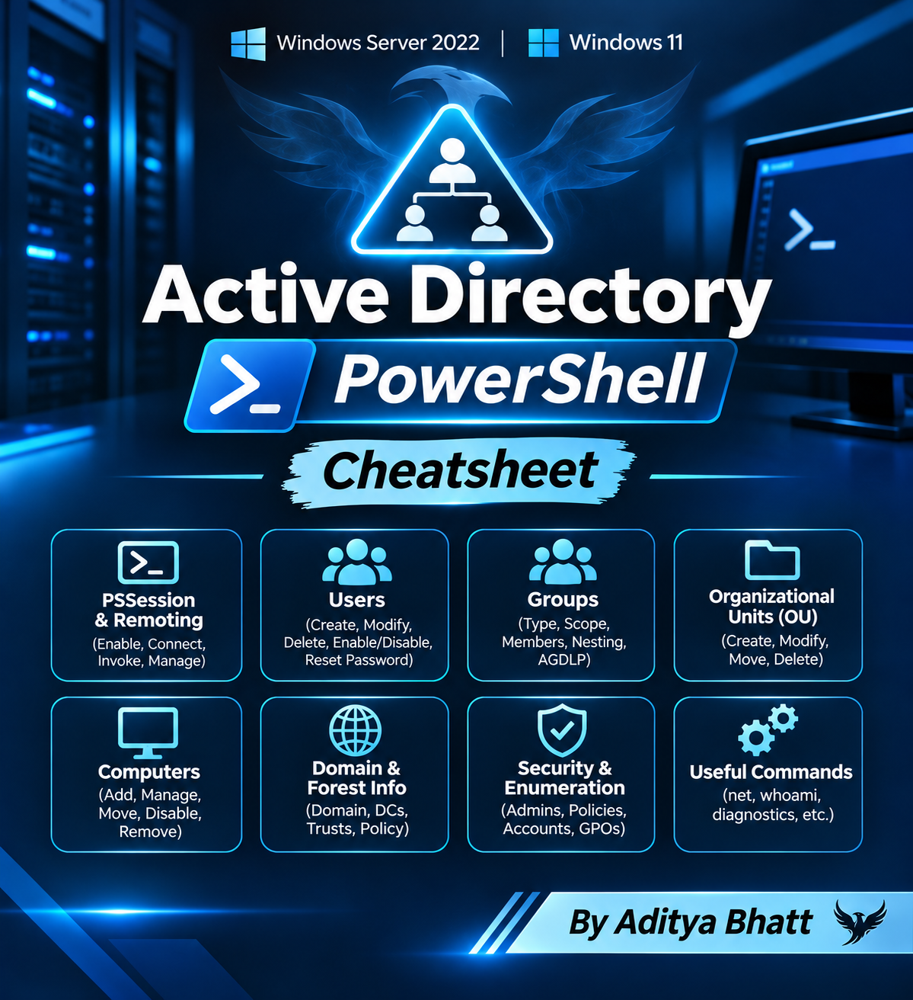

# Active Directory PowerShell Cheatsheet

**Windows Server 2022 | Windows 11 | PowerShell 5.1**



## 1\. PowerShell Remoting (PSSession)

### Enable and configure remoting

Run on the Domain Controller (DC), in an elevated PowerShell session:

``` powershell
Enable-PSRemoting -Force

Get-Service WinRM
winrm quickconfig
```

On the client (MC or WS):

``` powershell
Test-WSMan DC01
```

If DNS is configured correctly, use the DC hostname or FQDN.

### Create and manage sessions

``` powershell
# Create a persistent remote session
$cred = Get-Credential
$s = New-PSSession -ComputerName DC01 -Credential $cred

# Enter interactive remote session
Enter-PSSession -Session $s

# Execute commands remotely without entering
Invoke-Command -Session $s -ScriptBlock {
    Get-ADUser -Filter *
}

# Execute on a remote computer without a persistent session
Invoke-Command -ComputerName DC01 -Credential $cred -ScriptBlock {
    hostname
    Get-Service WinRM
}

# Run against multiple computers
Invoke-Command -ComputerName DC01,WS01 -Credential $cred -ScriptBlock {
    hostname
}

# List, disconnect, reconnect, and remove sessions
Get-PSSession
Disconnect-PSSession -Session $s
Connect-PSSession -Session $s
Remove-PSSession -Session $s

# Remove all sessions
Get-PSSession | Remove-PSSession
```

### PSSession essentials

| Command | Purpose |
| --- | --- |
| `New-PSSession` | Create persistent session |
| `Enter-PSSession` | Interactive remote shell |
| `Invoke-Command` | Run remote commands |
| `Exit-PSSession` | Leave interactive session |
| `Disconnect-PSSession` | Disconnect while preserving session |
| `Connect-PSSession` | Reconnect to disconnected session |
| `Remove-PSSession` | Close session |

**Important:** Variables created inside `Invoke-Command` normally exist remotely. Use `$Using:variable` to pass a local variable into a remote script block.

``` powershell
$name = "Alice"
Invoke-Command -Session $s -ScriptBlock {
    "Hello $Using:name"
}
```

## 2\. Active Directory module

``` powershell
# Import module
Import-Module ActiveDirectory

# Domain information
Get-ADDomain
Get-ADForest
Get-ADDomainController -Filter *

# Current domain
(Get-ADDomain).DNSRoot

# Domain SID
(Get-ADDomain).DomainSID

# Current user
whoami
whoami /user
whoami /groups
```

## 3\. Organizational Units (OU)

``` powershell
# List OUs
Get-ADOrganizationalUnit -Filter *

# Create OU
New-ADOrganizationalUnit -Name "IT" `
    -Path "DC=lab,DC=local"

# Create nested OU
New-ADOrganizationalUnit -Name "Admins" `
    -Path "OU=IT,DC=lab,DC=local"

# Search OU
Get-ADOrganizationalUnit -Filter 'Name -eq "IT"'

# Modify OU
Set-ADOrganizationalUnit -Identity "OU=IT,DC=lab,DC=local" `
    -Description "IT department"

# Delete OU (only if empty)
Remove-ADOrganizationalUnit -Identity "OU=IT,DC=lab,DC=local"

# Delete OU and its contents - destructive
Remove-ADOrganizationalUnit -Identity "OU=IT,DC=lab,DC=local" `
    -Recursive -Confirm:$false
```

## 4\. AD Users

### Create users

``` powershell
# Secure password prompt
$pw = Read-Host "Enter password" -AsSecureString

# Create a user
New-ADUser -Name "Alice Smith" `
    -GivenName "Alice" `
    -Surname "Smith" `
    -SamAccountName "asmith" `
    -UserPrincipalName "asmith@lab.local" `
    -Path "OU=IT,DC=lab,DC=local" `
    -AccountPassword $pw `
    -Enabled $true

# Create user with temporary password
New-ADUser -Name "Bob Jones" `
    -SamAccountName "bjones" `
    -UserPrincipalName "bjones@lab.local" `
    -AccountPassword (ConvertTo-SecureString "TempP@ss123!" `
        -AsPlainText -Force) `
    -Enabled $true `
    -ChangePasswordAtLogon $true
```

### Enumerate and search users

``` powershell
# All users
Get-ADUser -Filter *

# Specific user
Get-ADUser -Identity "asmith"

# Include additional attributes
Get-ADUser -Identity "asmith" -Properties *

# Search by name
Get-ADUser -Filter 'Name -like "*Alice*"'

# Enabled users
Get-ADUser -Filter 'Enabled -eq $true'

# Disabled users
Get-ADUser -Filter 'Enabled -eq $false'

# Users with descriptions
Get-ADUser -Filter * -Properties Description |
    Where-Object { $_.Description }

# List usernames only
Get-ADUser -Filter * |
    Select-Object -ExpandProperty SamAccountName

# Export users
Get-ADUser -Filter * -Properties Mail |
    Select-Object Name,SamAccountName,Mail |
    Export-Csv .\users.csv -NoTypeInformation
```

### Modify users

``` powershell
# Change attributes
Set-ADUser -Identity "asmith" `
    -Title "Security Analyst" `
    -Department "IT" `
    -Description "Lab user"

# Change username
Set-ADUser -Identity "asmith" `
    -SamAccountName "alice.smith"

# Move user to another OU
Move-ADObject -Identity "CN=Alice Smith,OU=IT,DC=lab,DC=local" `
    -TargetPath "OU=Admins,OU=IT,DC=lab,DC=local"

# Enable / disable
Enable-ADAccount -Identity "asmith"
Disable-ADAccount -Identity "asmith"

# Unlock account
Unlock-ADAccount -Identity "asmith"

# Reset password
Set-ADAccountPassword -Identity "asmith" `
    -Reset -NewPassword (Read-Host "New password" -AsSecureString)

# Force password change at next logon
Set-ADUser -Identity "asmith" -ChangePasswordAtLogon $true

# Set password never expires (lab only)
Set-ADUser -Identity "asmith" -PasswordNeverExpires $true

# Delete user
Remove-ADUser -Identity "asmith" -Confirm:$false
```

## 5\. AD Groups

### Group types and scopes

| Type / Scope | Purpose |
| --- | --- |
| Security | Assign permissions and rights |
| Distribution | Email distribution; not used for access control |
| Global | Members are typically accounts from the group's own domain; can be granted permissions in any trusted domain |
| Domain Local | Can contain accounts and groups from trusted domains; permissions are assigned in its own domain |
| Universal | Can contain accounts and groups from any domain in the forest; used across domains |

**AGDLP:** Accounts → Global groups → Domain Local groups → Permissions.

### Create and enumerate groups

``` powershell
# Create security group
New-ADGroup -Name "IT_Admins" `
    -GroupScope Global `
    -GroupCategory Security `
    -Path "OU=IT,DC=lab,DC=local"

# Create distribution group
New-ADGroup -Name "IT_MailingList" `
    -GroupScope Universal `
    -GroupCategory Distribution `
    -Path "OU=IT,DC=lab,DC=local"

# Enumerate groups
Get-ADGroup -Filter *

# Specific group
Get-ADGroup -Identity "IT_Admins"

# Groups with scope and category
Get-ADGroup -Filter * |
    Select-Object Name,GroupScope,GroupCategory
```

### Add and remove members

``` powershell
# Add one user
Add-ADGroupMember -Identity "IT_Admins" -Members "asmith"

# Add multiple users
Add-ADGroupMember -Identity "IT_Admins" `
    -Members "asmith","bjones"

# Add one group to another
Add-ADGroupMember -Identity "IT_Admins" `
    -Members "Helpdesk_Global"

# Remove member
Remove-ADGroupMember -Identity "IT_Admins" `
    -Members "asmith" -Confirm:$false

# List members
Get-ADGroupMember -Identity "IT_Admins"

# Include nested members
Get-ADGroupMember -Identity "IT_Admins" -Recursive

# Groups a user belongs to
Get-ADPrincipalGroupMembership -Identity "asmith" |
    Select-Object Name
```

### Modify and delete groups

``` powershell
# Change description
Set-ADGroup -Identity "IT_Admins" `
    -Description "IT administration group"

# Change scope
Set-ADGroup -Identity "IT_Admins" `
    -GroupScope Universal

# Change category
Set-ADGroup -Identity "IT_MailingList" `
    -GroupCategory Security

# Delete group
Remove-ADGroup -Identity "IT_Admins" -Confirm:$false
```

## 6\. Computers

``` powershell
# Enumerate computers
Get-ADComputer -Filter *

# Computer details
Get-ADComputer -Identity "WS01" -Properties *

# Create computer account
New-ADComputer -Name "WS02" `
    -SamAccountName "WS02$" `
    -Path "OU=Workstations,DC=lab,DC=local"

# Enable / disable
Disable-ADAccount -Identity "WS01$"
Enable-ADAccount -Identity "WS01$"

# Move computer
Move-ADObject -Identity "CN=WS01,OU=Computers,DC=lab,DC=local" `
    -TargetPath "OU=Workstations,DC=lab,DC=local"

# Delete computer
Remove-ADComputer -Identity "WS02" -Confirm:$false
```

## 7\. Built-in Windows commands (net)

These commands are useful when the AD module is unavailable or when validating domain membership and group relationships.

### Domain and user

``` cmd
:: Domain and logon information
whoami
whoami /user
whoami /groups
echo %USERDOMAIN%
echo %LOGONSERVER%
systeminfo

:: Domain users
net user /domain

:: Domain user details
net user alice /domain

:: Local users
net user

:: Create local user (admin shell)
net user labuser Password123! /add

:: Delete local user
net user labuser /delete
```

### Groups

``` cmd
:: Domain groups
net group /domain

:: Members of a domain group
net group "Domain Admins" /domain

:: Add domain user to domain group
net group "IT_Admins" alice /add /domain

:: Remove user from domain group
net group "IT_Admins" alice /delete /domain

:: Local groups
net localgroup

:: Members of local Administrators
net localgroup Administrators

:: Add local user to local group
net localgroup Administrators labuser /add

:: Remove local user from local group
net localgroup Administrators labuser /delete
```

### Domain membership

``` cmd
:: Check domain membership
systeminfo | findstr /B /C:"Domain"

:: Join domain (requires appropriate rights)
netdom join WS02 /domain:lab.local /userd:LAB\Administrator /passwordd:*
```

## 8\. Domain and security enumeration

``` powershell
# Domain information
Get-ADDomain
Get-ADForest
Get-ADDomainController -Filter *

# Domain password policy
Get-ADDefaultDomainPasswordPolicy

# Domain trusts
Get-ADTrust -Filter *

# Domain admins
Get-ADGroupMember "Domain Admins"

# Enterprise admins
Get-ADGroupMember "Enterprise Admins"

# Privileged groups
Get-ADGroup -Filter 'Name -like "*Admin*"'

# Group policy objects
Get-GPO -All

# Find locked accounts
Search-ADAccount -LockedOut

# Find disabled accounts
Search-ADAccount -AccountDisabled

# Find expired accounts
Search-ADAccount -AccountExpired

# Find inactive accounts
Search-ADAccount -AccountInactive -TimeSpan 90.00:00:00
```

## 9\. LDAP distinguished names (DN)

Example DN:

``` text
CN=Alice Smith,OU=IT,DC=lab,DC=local
```

| Component | Meaning |
| --- | --- |
| CN | Common Name |
| OU | Organizational Unit |
| DC | Domain Component |

For `lab.local`, the domain DN is `DC=lab,DC=local`.

## 10\. Useful PowerShell patterns

``` powershell
# Filter objects
Get-ADUser -Filter 'Enabled -eq $true'

# Select properties
Get-ADUser -Filter * |
    Select-Object Name,SamAccountName

# Sort
Get-ADUser -Filter * |
    Sort-Object Name

# Count
(Get-ADUser -Filter *).Count

# Export CSV
Get-ADUser -Filter * |
    Export-Csv .\users.csv -NoTypeInformation

# Import CSV
Import-Csv .\users.csv

# Pipeline to remove selected objects
Get-ADUser -Filter 'Name -like "Test*"' |
    Remove-ADUser -Confirm:$false

# Preview before deletion
Get-ADUser -Filter 'Name -like "Test*"' |
    Select-Object Name,DistinguishedName
```

## 11\. Troubleshooting

``` powershell
# Check DNS resolution
Resolve-DnsName DC01
nslookup lab.local

# Check connectivity
Test-Connection DC01
Test-NetConnection DC01 -Port 53
Test-NetConnection DC01 -Port 389
Test-NetConnection DC01 -Port 445
Test-NetConnection DC01 -Port 5985

# Check WinRM
Test-WSMan DC01

# Check domain secure channel
Test-ComputerSecureChannel -Verbose

# Check current logon server
$env:LOGONSERVER

# Check time synchronization
w32tm /query /status

# Force AD replication (DC only)
repadmin /syncall /AdeP

# Replication summary
repadmin /replsummary
```

## 12\. Quick reference

| Task | Command |
| --- | --- |
| Create user | `New-ADUser` |
| Delete user | `Remove-ADUser` |
| Create group | `New-ADGroup` |
| Delete group | `Remove-ADGroup` |
| Add group member | `Add-ADGroupMember` |
| Remove group member | `Remove-ADGroupMember` |
| List user groups | `Get-ADPrincipalGroupMembership` |
| Create OU | `New-ADOrganizationalUnit` |
| Move object | `Move-ADObject` |
| Reset password | `Set-ADAccountPassword` |
| Unlock account | `Unlock-ADAccount` |
| Enable / disable | `Enable-ADAccount` / `Disable-ADAccount` |
| Remote session | `New-PSSession` |
| Remote command | `Invoke-Command` |
| Interactive remote shell | `Enter-PSSession` |

**Lab safety:** Use dedicated test accounts and OUs. Review targets before bulk modifications or deletions. Avoid disabling security controls or changing privileged group membership on production domains.

---
